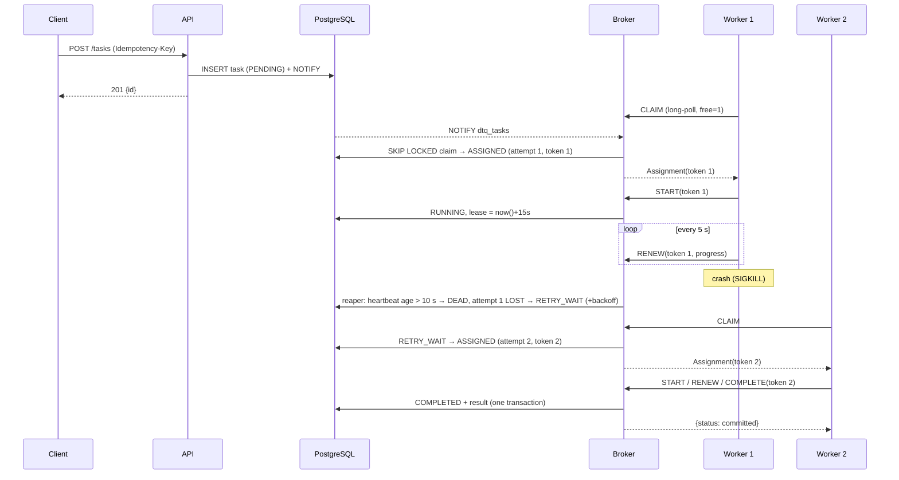
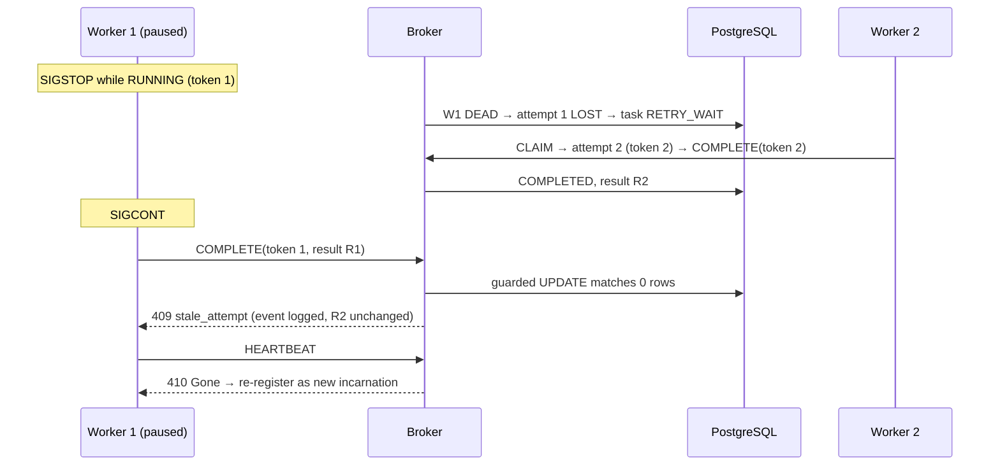

# API Contracts

Three HTTP services expose explicit network interfaces. All bodies are JSON (UTF-8). Interactive OpenAPI documentation is served by each FastAPI service at `/docs` (API: `http://localhost:8000/docs`).

Error envelope (all services):

```json
{"error": {"code": "stale_attempt", "message": "human readable text", "details": {}}}
```

Authentication headers:

| Header | Used by | Required for |
|---|---|---|
| `X-Cluster-Token` | workers, autoscaler, API → broker | every broker route under `/v1` |
| `X-Agent-Token` | autoscaler, API → agent | every agent route under `/v1` |
| `X-Admin-Token` | dashboard / scripts → API | mutating control routes (scaling, drain); fault injection and demo routes additionally require `DTQ_DEMO_MODE=true` |

---

## 1. Public API service (`api`, port 8000, prefix `/api/v1`)

### 1.1 Tasks

| Method & path | Purpose | Success | Errors |
|---|---|---|---|
| `GET /task-types` | Supported types, JSON schema, limits, defaults, examples | 200 | — |
| `POST /tasks` | Submit one task (S13 "Submit") | 201 new / 200 idempotent replay (`Idempotent-Replayed: true`) | 409 key reused with different request, 422 validation |
| `POST /tasks/batch` | Submit ≤ 1000 tasks atomically | 201 | 422 |
| `GET /tasks` | List/search/filter | 200 `{items,total}` | 422 |
| `GET /tasks/{id}` | Status + result + attempts + transitions + events (S13 "Status + result") | 200 | 404 |
| `GET /batches/{batch_id}` | Batch counts and timing; `?include_tasks=true` returns per-task timing rows | 200 | 404 |

`POST /tasks` request:

```json
{
  "type": "prime_count",
  "payload": {"start": 0, "end": 2000000},
  "priority": 0,
  "max_attempts": 3,
  "timeout_seconds": 60,
  "namespace": "default",
  "idempotency_key": "order-42"
}
```

The idempotency key may also be sent as the `Idempotency-Key` header (draft-ietf-httpapi-idempotency-key-header). `request_hash = sha256(type, canonical payload, options)` detects key reuse with a different body.

Task representation (`TaskOut`):

```json
{
  "id": "6f1c…", "seq": 42, "type": "prime_count", "namespace": "default",
  "status": "COMPLETED", "priority": 0, "payload": {…},
  "attempt_count": 2, "max_attempts": 3, "timeout_seconds": 60,
  "assigned_worker_id": "…", "assigned_worker_name": "worker-3f9c2b",
  "result": {…}, "last_error": null,
  "created_at": "…", "first_assigned_at": "…", "started_at": "…",
  "completed_at": "…", "failed_at": null, "available_at": "…",
  "lease_expires_at": null, "batch_id": null, "idempotency_key": "order-42",
  "queue_wait_ms": 120, "execution_ms": 940, "latency_ms": 1600
}
```

`GET /tasks` query parameters: `status` (repeatable), `type`, `namespace`, `batch_id`, `worker_id`, `q` (id prefix or idempotency key), `retried=true`, `limit` (≤ 500, default 50), `offset`, `order=created_desc|created_asc`.

### 1.2 Workers

| Method & path | Purpose | Auth |
|---|---|---|
| `GET /workers?include_stopped=false` | Registry with health (`HEALTHY/SUSPECT/DEAD/DRAINING/STOPPED`), heartbeat age, capacity, active assignments, utilization, counters, agent process state (S13 "Worker health") | — |
| `GET /workers/{id}` | Details + recent attempts | — |
| `POST /workers/{id}/drain` | Queue a graceful stop (autoscaler executes) → 202 `{command_id}` | admin |
| `POST /workers/{id}/kill` | **Fault injection:** SIGKILL the worker process/container → `{killed_at}` (DB time) | admin + demo |
| `POST /workers/{id}/pause` `{"seconds": 20}` | **Fault injection:** freeze the worker (SIGSTOP/`docker pause`) then resume | admin + demo |

### 1.3 Scaling

| Method & path | Purpose | Auth |
|---|---|---|
| `GET /scaling` | Config, controller state (desired/actual, heartbeat, pressure/idle timers), agent inventory | — |
| `PUT /scaling/config` | Partial update of thresholds/limits (validated, recorded as `config_change`) | admin |
| `POST /scaling/mode` `{"mode": "auto"\|"manual"}` | Switch mode | admin |
| `POST /scaling/target` `{"target": 5}` | Manual capacity (switches to manual) | admin |
| `GET /scaling/decisions?limit=100` | Decision history | — |

### 1.4 Metrics, analytics, events, system

| Method & path | Purpose |
|---|---|
| `GET /metrics?namespace=` | Counts by status, submitted/retried/failed totals, throughput (1 min / 5 min), mean execution time, mean queue wait, p50/p95 latency, workers live/busy/idle, utilization (S13 "Statistics") |
| `GET /metrics/timeseries?minutes=30` | `metrics_samples` rows |
| `GET /analytics?minutes=60&namespace=` | Per-minute throughput/latency/queue-wait series, per-type execution statistics, completion rate, retry & failure breakdown, recovery delays, per-worker utilization |
| `GET /events?severity=&component=&event_type=&task_id=&worker_id=&after_id=&limit=` | System log |
| `GET /system/health` | Component health: api, database (latency), broker, autoscaler (heartbeat age), agents, workers |
| `GET /system/topology` | Nodes and edges for the architecture view with live task counts |
| `GET /system/info` | Version, demo mode, non-secret configuration |
| `POST /admin/verify` | Validate an admin token (dashboard unlock) |
| `POST /system/services/{service}/restart` | Restart an allow-listed service container through a docker-backed agent (admin + demo; used for persistence demonstrations) |

### 1.5 Demo and benchmarks

| Method & path | Purpose | Auth |
|---|---|---|
| `GET /demo/scenarios` | Scenarios A–G with description and last run | — |
| `POST /demo/scenarios/{key}/run` | Start scenario (`A`…`G`) → 202 `{run_id}` | admin + demo |
| `GET /demo/runs` | Recent scenario runs | — |
| `GET /demo/runs/{run_id}` | Live step log, verdict, measurements | — |
| `POST /demo/reset` | Delete demo-namespace data only | admin + demo |
| `GET /benchmarks` | Recorded benchmark runs | — |
| `POST /benchmarks` | Record a benchmark run (used by `benchmarks/`) | admin |

### 1.6 WebSocket `GET /ws`

Server → client frames:

```json
{"type": "hello", "server_time": "…", "last_event_id": 1234}
{"type": "events", "items": [ {"id": 1235, "ts": "…", "severity": "INFO", "component": "broker", "event_type": "task.assigned", "message": "…", "task_id": "…", "worker_id": "…", "details": {}} ]}
{"type": "metrics", "data": { …same as GET /metrics… }}
{"type": "workers", "data": [ …same as GET /workers… ]}
{"type": "scaling", "data": { …same as GET /scaling… }}
```

Client → server: `{"type": "ping"}` → `{"type": "pong"}`. Clients reconnect with exponential backoff and back-fill with `GET /events?after_id=<last seen>`.

---

## 2. Broker protocol (`broker`, port 8001, prefix `/v1`)

| Message | Method & path | Request | Response |
|---|---|---|---|
| REGISTER | `POST /v1/workers/register` | `{name, host, pid, capacity, agent_id?, version, labels?}` | `{worker_id, heartbeat_interval_s, lease_duration_s, renew_interval_s, claim_wait_s, server_time}` |
| HEARTBEAT | `POST /v1/workers/{id}/heartbeat` | `{state: "active"\|"draining", active: [{task_id, attempt_id, fencing_token}], free_slots}` | `{status, revoked: [task_id…], server_time}`; **410** if the broker considers this incarnation dead/stopped/unknown |
| CLAIM | `POST /v1/workers/{id}/claim` | `{max_tasks, wait_s}` | `{tasks: [Assignment]}` (empty on timeout); 409 draining; 410 dead |
| START (ack) | `POST /v1/tasks/{task_id}/start` | `{worker_id, attempt_id, fencing_token}` | `{lease_expires_at}`; 409 `stale_attempt`/`lease_expired` |
| RENEW | `POST /v1/tasks/{task_id}/renew` | `{worker_id, attempt_id, fencing_token, progress?, message?}` | `{lease_expires_at}`; 409 → stop executing |
| COMPLETE | `POST /v1/tasks/{task_id}/complete` | `{worker_id, attempt_id, fencing_token, result, duration_ms}` | `{status: "committed"\|"duplicate"}`; 409 `stale_attempt` |
| FAIL | `POST /v1/tasks/{task_id}/fail` | `{worker_id, attempt_id, fencing_token, error_type, message, retryable, duration_ms}` | `{status: "retry_scheduled"\|"failed"\|"duplicate", next_attempt_at}`; 409 |
| DRAIN | `POST /v1/workers/{id}/drain` | `{reason}` | `{status: "DRAINING"}` |
| DEREGISTER | `POST /v1/workers/{id}/deregister` | `{reason}` | `{status: "STOPPED", released: n}` |
| STATS | `GET /v1/stats` | — | dispatcher counters (cycles, assignments, waiting claimants, stale rejections) |
| HEALTH | `GET /health` | — | `{status, database, recovery_leader}` (no auth) |

`Assignment`:

```json
{"task_id": "…", "attempt_id": "…", "fencing_token": 2, "type": "delay",
 "payload": {"seconds": 5}, "timeout_seconds": 60, "max_attempts": 3,
 "lease_expires_at": "…"}
```

### Sequence: normal execution and crash recovery



### Sequence: stale result rejection (S12 example)



---

## 3. Worker agent (`agent`, port 8003, prefix `/v1`)

| Method & path | Purpose |
|---|---|
| `GET /health` | `{agent_id, backend, managed, max_workers}` (no auth) |
| `GET /v1/workers` | Managed workers: `{name, handle, state: starting\|running\|paused\|stopping\|exited, started_at, exit_code, capacity}` |
| `POST /v1/workers` `{count, capacity?}` | Start real workers (bounded by `DTQ_AGENT_MAX_WORKERS`) |
| `POST /v1/workers/{name}/stop` `{timeout_s}` | Graceful stop: SIGTERM / `docker stop -t` |
| `POST /v1/workers/{name}/kill` | SIGKILL / `docker kill` |
| `POST /v1/workers/{name}/pause` `{seconds}` | SIGSTOP+SIGCONT / `docker pause`+`unpause` |
| `POST /v1/services/{service}/restart` | Docker backend, demo mode only, allow-listed services (`broker`, `api`) for persistence demonstrations |
