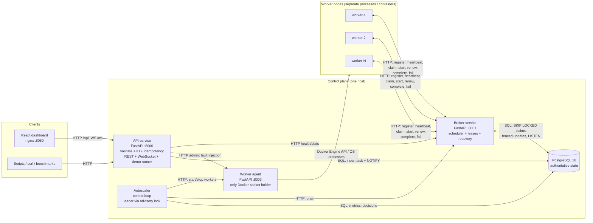
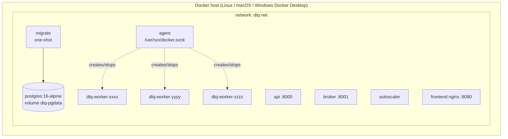

# Architecture

## 1. Architectural drivers

1. **Correctness under failure** (S3, S7, S11, S12): no task may silently disappear; no task may have two valid owners; at most one visible result.
2. **Real distribution** (S5): every node is a separate process that communicates only through explicit network interfaces.
3. **Explainability** (S8 Approach B): the queue, scheduler, leases, recovery and scaling are *our* code and can be walked through line by line.
4. **Observability** (S4): every state change is persisted and streamed to the dashboard.
5. **Pragmatic scope** (S15): one machine by default, multi-machine by configuration; no Kubernetes.

## 2. Alternatives considered

| Option | Description | Pros | Cons | Verdict |
|---|---|---|---|---|
| A. RabbitMQ/Celery (S8 Approach A) | Off-the-shelf broker; workers consume with `acks_late` | Fast to build, battle-tested | Core mechanisms are not our code; contradicts brief | Rejected |
| B1. In-memory custom broker (sockets) | Broker keeps queue in RAM, snapshots to disk | Simple protocol, fast | Broker crash loses tasks unless WAL is implemented; complex | Rejected |
| B2. Custom broker, **PostgreSQL as authoritative queue** | Broker = stateless HTTP service implementing scheduling/leases/recovery with atomic SQL (`FOR UPDATE SKIP LOCKED`), DB = durable log of state | Durability and atomicity from a proven engine; broker restarts are trivial; all algorithms remain ours | DB is a single point of failure (documented); polling cost mitigated with LISTEN/NOTIFY | **Selected** |
| B3. Raft-replicated custom broker | Replicate broker state across 3 nodes | Broker HA | Large scope, high risk for a course project | Future work |
| Push vs pull dispatch | Broker pushes to workers vs workers request work | Push: central control. Pull: workers know their own capacity, natural back-pressure | Push needs worker endpoints/NAT traversal | **Hybrid**: workers long-poll (`claim`), broker arbitrates who gets which task (least-loaded, round-robin) |
| Worker transport | Raw TCP / WebSocket / HTTP | — | — | **HTTP/JSON** (debuggable with curl, firewall friendly, explicit message schema) |

## 3. Final architecture

Key properties:

* **Workers never touch the database.** Their only interface is the broker protocol (S5: "Broker: queue + dispatch"). This keeps credentials off worker hosts and makes the broker the single enforcement point for fencing.
* **The database is the only authority.** Broker, API and autoscaler hold only soft state (waiting long-polls, caches). Any of them can restart at any time.
* **Time is database time.** Leases, heartbeat ages, backoff and deadlines are compared with PostgreSQL `now()`, so worker clock skew is irrelevant.

## 4. Components and responsibilities (S6)

| Component | Process | Responsibilities | Owner (S19) |
|---|---|---|---|
| API (Producer) | `python -m dtq api` | Validate payloads (typed specs), generate UUIDs, idempotent submission, task/worker/metrics/events queries, scaling configuration, WebSocket fan-out, demo scenarios, admin auth | Omar |
| Broker | `python -m dtq broker` | Worker registry, heartbeats, capacity-aware fair dispatch, atomic claims, leases, fencing, ack/complete/fail, stale-result rejection | Reem |
| Recovery (inside broker, leader-elected) | broker background task | Suspect/dead detection, lease expiry, deadline enforcement, retry backoff, exhaustion → FAILED, restart grace period | Malak |
| Worker runtime | `python -m dtq worker` | Register, heartbeat, claim, ack, execute (CPU tasks in killable child processes, waiting tasks as coroutines), renew, progress, report, reconnect, drain | Malak |
| Database & lifecycle | PostgreSQL + `migrations/` + `dtq.db` | Schema, constraints, transition trigger, repositories, transactional commits, idempotency storage | Lama |
| Worker agent | `python -m dtq agent` | Start/stop/kill/pause real worker containers (Docker backend) or OS processes (process backend); bounded by a hard cap | Habiba |
| Autoscaler | `python -m dtq autoscaler` | Measure → decide → act → wait loop, manual/auto modes, decisions log, metrics sampling, command processing | Habiba |
| Dashboard | nginx + React build | Eight pages of live monitoring and control | Habiba |
| Benchmarks | `benchmarks/` | Experiments A–D, CSV + graphs | Habiba |
| Integration | compose, Dockerfiles, config, shared protocol models | Omar |

## 5. Deployment views

### 5.1 Single host (default, `docker compose up --build`)

Published ports: `8080` dashboard, `8000` API (+ OpenAPI docs), `8001` broker (for remote workers), `127.0.0.1:5433` PostgreSQL (debug only). Worker containers are created at runtime by the agent from the same `dtq-backend` image.

### 5.2 Multiple machines

* Host A runs the compose stack.
* Host B..N run either plain workers (`python -m dtq worker --broker-url http://hostA:8001`) or an extra agent (`DTQ_AGENT_BACKEND=process`) that the autoscaler controls (`DTQ_AGENT_URLS=http://agent:8003,http://hostB:8003`).
* Only the broker port (and optionally agent ports) must be reachable; tokens (`DTQ_CLUSTER_TOKEN`, `DTQ_AGENT_TOKEN`) authenticate internal calls. See `docs/MULTI_MACHINE.md`.

## 6. Communication summary

| From → To | Transport | Messages | Semantics |
|---|---|---|---|
| Client → API | HTTP/JSON | submit, batch, query, control | Idempotency-Key for safe retries |
| API → DB | SQL | insert task + `NOTIFY dtq_tasks` in one transaction | Ack only after commit |
| Worker → Broker | HTTP/JSON | REGISTER, HEARTBEAT, CLAIM (long-poll), START (ack), RENEW, COMPLETE, FAIL, DRAIN, DEREGISTER | All mutating task messages carry `(attempt_id, fencing_token)` |
| Broker → DB | SQL | `SELECT … FOR UPDATE SKIP LOCKED`, conditional `UPDATE … WHERE current_attempt_id=… AND attempt_count=…` | Atomic, fenced |
| DB → Broker/API | LISTEN/NOTIFY | `dtq_tasks` (new work), `dtq_events` (new event rows) | Wake-up hints only; periodic polling is the safety net |
| Autoscaler → Agent | HTTP/JSON | list, start, stop (graceful), kill, pause | Agent enforces a hard worker cap |
| API → Dashboard | WebSocket | `events`, `metrics`, `workers`, `scaling` frames | Client reconnects with backoff and back-fills via REST |

## 7. Coordination mechanisms (S10)

| Concept | Mechanism | Where |
|---|---|---|
| Mutual exclusion on claims | Row locks with `SKIP LOCKED` + conditional updates | `dtq/broker/scheduler.py`, `dtq/db/lifecycle.py` |
| Ownership | Leases (`lease_expires_at`, DB time), renewal | broker `start/renew` |
| Stale-owner protection | Fencing token = per-task monotonically increasing attempt number | broker `complete/fail/renew` |
| Failure detection | Heartbeats → SUSPECT → DEAD (unreliable failure detector) | `dtq/broker/recovery.py` |
| Leader election for singleton loops | `pg_try_advisory_lock` held on a dedicated session | broker reaper, autoscaler |
| Change notification | PostgreSQL LISTEN/NOTIFY | broker dispatcher, API WebSocket pump |
| Command queue | `control_commands` table processed by the autoscaler | drain requests from the API |

## 8. Failure model (summary — detail in `TECHNICAL_DESIGN.md §6`)

* Workers: crash-stop, crash-recovery, arbitrary pauses (GC, SIGSTOP), and network partitions/delays. **Handled.**
* Broker, API, autoscaler, agent: crash-restart. **Handled** (stateless; DB authoritative; lease grace period).
* PostgreSQL: assumed available and durable (single instance with a persistent volume). Its failure stops progress but loses no committed data. HA is out of scope (documented limitation).
* No Byzantine behaviour: authenticated components follow the protocol; tokens protect against accidental/unauthenticated misuse, not against a compromised host.
