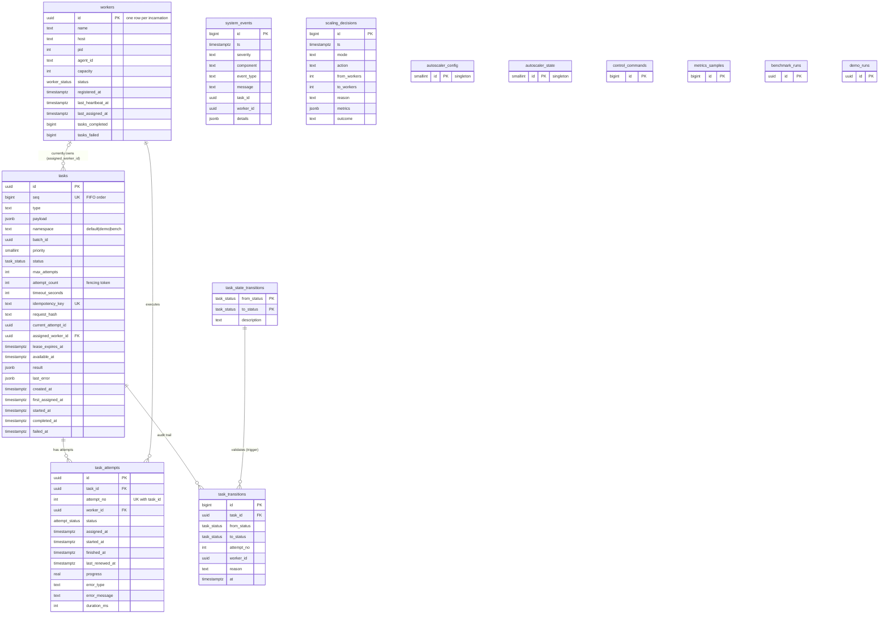

# Database Design

PostgreSQL 16 is the **authoritative source of truth** for every task, attempt, worker, event and scaling decision. All migrations live in `backend/migrations/*.sql` and are applied in order by `python -m dtq migrate` (advisory-locked, checksummed, recorded in `schema_migrations`).

## 1. Entity–relationship diagram

## 2. Enumerated types

| Type | Values |
|---|---|
| `task_status` | `PENDING, ASSIGNED, RUNNING, COMPLETED, RETRY_WAIT, FAILED` |
| `attempt_status` | `ASSIGNED, RUNNING, SUCCEEDED, FAILED, TIMED_OUT, LOST, RELEASED` |
| `worker_status` | `ACTIVE, SUSPECT, DRAINING, DEAD, STOPPED` |

## 3. Tables

### 3.1 `tasks` — persistent queue + current state
Key constraints (all enforced by PostgreSQL, not just application code):

| Constraint | Meaning |
|---|---|
| `PRIMARY KEY (id)` | UUID generated by the API (uuid4) |
| `UNIQUE (seq)` identity | strict FIFO order of submission |
| `UNIQUE (idempotency_key)` | duplicate submissions collapse to one task |
| `attempts_within_limit` | `attempt_count ≤ max_attempts` |
| `owned_states_have_owner` | `ASSIGNED/RUNNING ⇒ current_attempt_id, assigned_worker_id, lease_expires_at NOT NULL` |
| `unowned_states_have_no_lease` | other states ⇒ `lease_expires_at IS NULL` |
| `completed_has_result` | `COMPLETED ⇒ result, completed_at NOT NULL` |
| `result_only_when_completed` | a result can only exist on a `COMPLETED` task |
| `failed_has_error` | `FAILED ⇒ failed_at, last_error NOT NULL` |
| `running_has_start` | `RUNNING ⇒ started_at NOT NULL` |
| checks on ranges | `max_attempts 1..10`, `timeout_seconds 1..3600`, `priority −10..10`, type/namespace patterns |

Indexes: partial dispatch index `(priority DESC, seq) WHERE status IN ('PENDING','RETRY_WAIT')`; partial lease index `(lease_expires_at) WHERE status IN ('ASSIGNED','RUNNING')`; active-ownership index `(assigned_worker_id) WHERE status IN ('ASSIGNED','RUNNING')`; `(status)`, `(created_at DESC)`, `(completed_at)`, `(batch_id)`, `(namespace, created_at DESC)`, `(type)`.

### 3.2 `task_attempts` — attempt history (S13 "attempts")
One row per assignment. `UNIQUE (task_id, attempt_no)` makes double-assignment of the same attempt number impossible. `finished_at` is required once the attempt reaches a terminal attempt status.

### 3.3 `workers` — registry (S13 "workers")
One row per **incarnation**: a worker that re-registers after being declared dead receives a new id, so fencing by attempt also fences by incarnation. `last_heartbeat_at` uses DB time.

### 3.4 `task_state_transitions` + `task_transitions`
* `task_state_transitions` is the state machine *as data* (7 rows, each with a description).
* Trigger `tasks_enforce_transition` (`BEFORE INSERT OR UPDATE OF status`) rejects tasks inserted in any state other than `PENDING` and any transition missing from the table (SQLSTATE `DT001`).
* Trigger `tasks_log_transition` (`AFTER INSERT OR UPDATE OF status`) appends to `task_transitions` with the reason from `current_setting('dtq.reason', true)`.

### 3.5 Observability tables
* `system_events`: append-only log; statement-level trigger sends `NOTIFY dtq_events`.
* `metrics_samples`: 5-second samples written by the autoscaler (queue depth, workers, utilization, totals).
* `scaling_decisions`: every action with reason and metrics snapshot.
* `autoscaler_config` (singleton, user intent; range checks incl. `min ≤ max ≤ 16`, `down_util < up_util`) and `autoscaler_state` (singleton, controller status/heartbeat).
* `control_commands`: queue of operator commands (`drain_worker`) consumed by the autoscaler.
* `benchmark_runs`, `demo_runs`: experiment and scenario records.

## 4. Critical transactions

| Operation | Statements (single transaction) | Isolation argument |
|---|---|---|
| Submit | `INSERT tasks … ON CONFLICT (idempotency_key) DO NOTHING RETURNING` → (if conflict) `SELECT` and compare `request_hash`; `INSERT system_events`; statement trigger `NOTIFY dtq_tasks` | Unique index decides the single winner; NOTIFY is delivered only on commit |
| Dispatch | `SELECT workers … FOR UPDATE`; `SELECT tasks … FOR UPDATE SKIP LOCKED`; per pair `INSERT task_attempts` + guarded `UPDATE tasks`; `UPDATE workers.last_assigned_at`; events | Row locks + guarded WHERE + trigger + unique attempt |
| Start / Renew | single guarded `UPDATE tasks … WHERE current_attempt_id=$a AND attempt_count=$t AND status=… AND lease_expires_at > now()` + attempt update | Compare-and-set on the fencing token |
| Complete | guarded `UPDATE tasks SET status='COMPLETED', result=…` + `UPDATE task_attempts` + `UPDATE workers.tasks_completed` + event | All-or-nothing; constraints forbid a second result |
| Fail / Recover | guarded `UPDATE` to `RETRY_WAIT` (+`available_at`) then, if exhausted, `UPDATE` to `FAILED` | Same transaction → never stuck |
| Migrations | `pg_advisory_xact_lock` + each file in its own transaction | Concurrent starters serialize |

## 5. Time and identifiers

* All timestamps are `timestamptz`; lease/heartbeat comparisons use the database `now()` (transaction start time; transactions are short).
* UUIDs: task ids generated by the API; attempt ids by the broker; worker ids by the database (`gen_random_uuid()`).

## 6. Retention

The schema keeps everything (academic inspection). `POST /api/v1/demo/reset` deletes only `namespace='demo'` tasks (cascading to attempts and transitions), their events and `demo_runs`. Benchmark tasks use `namespace='bench'`.
