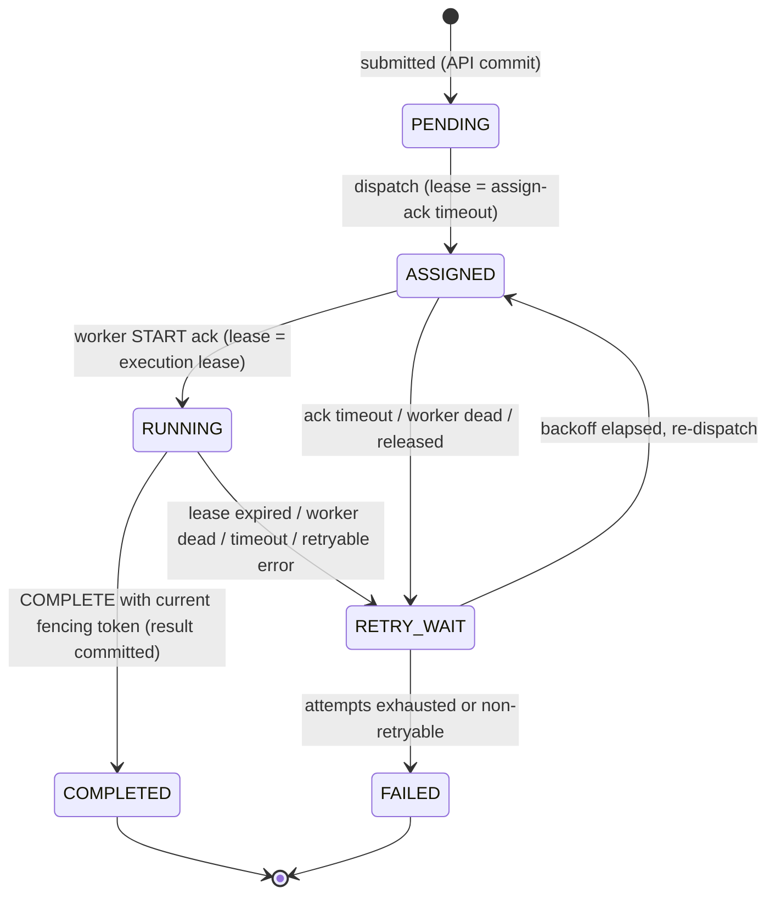
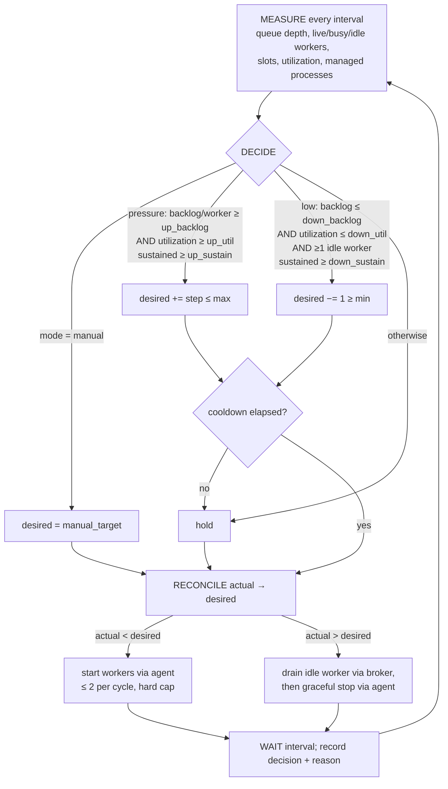

# Technical Design

This document specifies the algorithms and protocols implemented in `backend/dtq`. Configuration names refer to environment variables (prefix `DTQ_`) validated in `dtq/common/config.py`.

---

## 1. Task lifecycle (S7)



* Allowed transitions are stored as data in table `task_state_transitions` and enforced by the `BEFORE UPDATE` trigger `tasks_enforce_transition`. Any other transition raises SQLSTATE `DT001`.
* Every transition is written to `task_transitions` by an `AFTER` trigger, including the reason (`set_config('dtq.reason', …, true)` per transaction). This makes the lifecycle audit trail impossible to bypass.
* A failing attempt always passes through `RETRY_WAIT` (literal S7 semantics); when no attempts remain, `RETRY_WAIT → FAILED` is executed in the **same transaction**, so a task is never observed "stuck" in `RETRY_WAIT` without a future.

## 2. Scheduling and dispatch (custom broker)

### 2.1 Policy

* **Task order:** FIFO by submission sequence (`seq`), after integer `priority` (default 0 for all tasks, so pure FIFO unless a client opts in). Tasks in `RETRY_WAIT` become eligible when `available_at ≤ now()` and keep their original `seq`.
* **Worker selection:** capacity-aware, least-loaded first. Among workers currently waiting for work (`claim` long-polls), order by
  1. utilization `active / capacity` (ascending),
  2. `last_assigned_at` (ascending, never-assigned first) → round-robin fairness,
  3. claim arrival time.
* **Distribution:** round-robin rounds — each eligible worker receives one task per round until tasks or free slots run out. A worker never receives more than `capacity − active` tasks.

### 2.2 Claim protocol (pull transport, central arbitration)

```
POST /v1/workers/{id}/claim {max_tasks, wait_s}
1. Reject (409) if worker is not ACTIVE; 410 if unknown/DEAD/STOPPED.
2. Redelivery: return tasks already ASSIGNED to this worker whose lease is still valid
   (covers a lost HTTP response to a previous claim).
3. Register a Claimant(worker_id, max_tasks, future); wake the dispatcher.
4. Await the future up to wait_s (default 20 s). Timeout → {"tasks": []}.
```

Dispatcher cycle (one coroutine per broker; woken by NOTIFY `dtq_tasks`, by new claimants, and by a 500 ms tick):

```sql
BEGIN;
-- lock claimant worker rows → no other broker replica can over-assign them
SELECT id, capacity, last_assigned_at,
       (SELECT count(*) FROM tasks t WHERE t.assigned_worker_id = w.id
          AND t.status IN ('ASSIGNED','RUNNING')) AS active
  FROM workers w WHERE w.id = ANY($claimants) AND w.status = 'ACTIVE' FOR UPDATE;
-- lock up to Σ free_slots eligible tasks; rows locked by others are skipped, never double-assigned
SELECT id, attempt_count, ... FROM tasks
 WHERE (status = 'PENDING' OR status = 'RETRY_WAIT') AND available_at <= now()
 ORDER BY priority DESC, seq
 LIMIT $total FOR UPDATE SKIP LOCKED;
-- for each (task, worker) pair chosen by round-robin:
INSERT INTO task_attempts (id, task_id, attempt_no, worker_id, status) VALUES (..., 'ASSIGNED');
UPDATE tasks SET status='ASSIGNED', attempt_count = attempt_count + 1,
       current_attempt_id = $a, assigned_worker_id = $w,
       lease_expires_at = now() + assign_ack_timeout,
       first_assigned_at = coalesce(first_assigned_at, now())
 WHERE id = $t AND status IN ('PENDING','RETRY_WAIT');
UPDATE workers SET last_assigned_at = now() WHERE id = ANY($assigned);
INSERT INTO system_events ... ('task.assigned');
COMMIT;  -- only after commit are futures resolved and assignments sent
```

Why this is race-free: the row lock on each task is held until commit; `SKIP LOCKED` makes concurrent dispatchers take disjoint sets; the transition trigger rejects any update that does not start from `PENDING`/`RETRY_WAIT`; and the unique `(task_id, attempt_no)` constraint rejects duplicate attempts.

### 2.3 Worker acknowledgement and leases

| Message | Precondition (checked atomically in the `UPDATE … WHERE`) | Effect |
|---|---|---|
| `START` | `status='ASSIGNED' ∧ current_attempt_id=a ∧ attempt_count=token ∧ assigned_worker_id=w` | `RUNNING`, `started_at=now()`, lease = `now()+lease_duration`; a repeated START is acknowledged idempotently |
| `RENEW` | `status='RUNNING' ∧ current_attempt_id=a ∧ token ∧ now() ≤ started_at + timeout + grace` | lease = `now()+lease_duration`; stores progress |
| `COMPLETE` | `status='RUNNING' ∧ current_attempt_id=a ∧ token` | `COMPLETED`, result stored, attempt `SUCCEEDED`, worker counters — one transaction |
| `FAIL` | same as COMPLETE | attempt `FAILED`/`TIMED_OUT`; task → `RETRY_WAIT` (+backoff) or → `FAILED` |

`START`, `RENEW` and `COMPLETE` deliberately do **not** require the lease to be unexpired: ownership ends when the recovery loop actually reassigns the task, not when the clock passes. Until then the current attempt is the only owner and may still act; once recovery moves the task to `RETRY_WAIT`, the token no longer matches and every late message is rejected. Safety comes from fencing; leases only decide *when* recovery may act (liveness).

Responses for a non-matching message:

* Same attempt, task already `COMPLETED` by this attempt → `200 {"status": "duplicate"}` (idempotent acknowledgement; no effect re-applied).
* Otherwise → `409` with code `stale_attempt` (a newer attempt exists), `lease_expired` / `deadline_exceeded` (recovery already took this attempt's task) or `invalid_state`; an event `task.stale_{start|renew|result|failure}_rejected` is recorded.

## 3. Failure detection and recovery (S10, S11)

Recovery runs in the broker but only on the instance holding advisory lock `dtq.recovery` (leader election). Every `DTQ_REAPER_INTERVAL_S` (1 s):

1. **Suspect:** `ACTIVE` workers with `last_heartbeat_at < now() − suspect_after` (6 s) → `SUSPECT` (event WARNING). Suspects receive no new work. A heartbeat from a suspect restores `ACTIVE` ("false suspicion cleared", S11).
2. **Dead:** workers with `last_heartbeat_at < now() − dead_after` (10 s) → `DEAD`; all their `ASSIGNED`/`RUNNING` tasks get `lease_expires_at = now()` so step 3 recovers them immediately.
3. **Lease expiry:** `SELECT … WHERE status IN ('ASSIGNED','RUNNING') AND lease_expires_at < now() FOR UPDATE SKIP LOCKED` → attempt marked `LOST` (`error_type` = `WORKER_DEAD`, `ASSIGN_ACK_TIMEOUT` or `LEASE_EXPIRED`) → task `RETRY_WAIT` with backoff, or `FAILED` when exhausted.
4. **Deadline:** `RUNNING` tasks with `now() > started_at + timeout_seconds + deadline_grace` → attempt `TIMED_OUT` → retry/fail. (The worker normally enforces the timeout itself; this is defence in depth.)
5. **Wake-up:** if anything became eligible, wake the dispatcher.

**Restart grace (Chubby-style):** when an instance acquires recovery leadership it extends all active leases and refreshes live workers' heartbeat timestamps by one lease period, because workers could not renew while no broker was reachable. Without this, every broker restart longer than the lease would cause spurious re-execution.

### 3.1 Retry backoff

`delay(n) = min(max_backoff, base · 2^(n−1)) · (1 + U(−j, +j))`, with `n` = attempts made so far, `base=1 s`, `max=30 s`, jitter `j = 0.1` (0 in tests for determinism). Stored as `available_at = now() + delay`.

### 3.2 Failure-scenario matrix

| Scenario | Detection | Outcome |
|---|---|---|
| Crash before execution (after claim) | ack timeout (10 s) or dead worker | `ASSIGNED → RETRY_WAIT → ASSIGNED` to another worker |
| Crash during execution | missed heartbeats → DEAD (≤10 s) | attempt `LOST`, task retried elsewhere |
| Crash after execution, before COMPLETE | same | task re-executed (at-least-once); single committed result |
| Unresponsive (paused) worker | SUSPECT then DEAD | task reassigned; on resume, worker's heartbeat → 410, it cancels revoked work and re-registers as a new incarnation; its late COMPLETE → 409 stale |
| Temporary connectivity loss < 10 s | SUSPECT only | resumes normally (false suspicion cleared) |
| Exception in handler | worker reports FAIL | retry with backoff, or FAILED if non-retryable/exhausted |
| Runtime exceeded | worker kills child at `timeout_seconds`; broker deadline as backup | `TIMED_OUT` attempt, retry |
| Broker restart | — | workers retry with backoff; leases extended by grace; long-polls re-issued; nothing lost |
| API restart | — | stateless; clients retry with Idempotency-Key |
| Concurrent claims | — | `SKIP LOCKED` + trigger + unique attempt |
| Stale result | fencing token mismatch | 409, event, committed result unchanged |
| Duplicate ack | same attempt already committed | 200 `duplicate`, no re-application |
| Duplicate submission | unique `idempotency_key` + request hash | original task returned; mismatched reuse → 409 |
| Retry exhaustion | `attempt_count ≥ max_attempts` | `RETRY_WAIT → FAILED`, full attempt history |

## 4. Delivery semantics (S12)

* **Submission:** exactly-once *task creation* per idempotency key (unique index); at-least-once client retries are therefore safe.
* **Execution:** **at-least-once attempts**, bounded by `max_attempts`. A task may execute more than once (crash after execution, false suspicion). Handlers are deterministic and side-effect free, so re-execution produces the same value.
* **Visible result:** **exactly-once effect** — the result is written by a single conditional `UPDATE` that requires the current fencing token and `RUNNING` status; the `completed_has_result` / `result_only_when_completed` constraints guarantee one result column per task. Duplicate COMPLETE from the same attempt is acknowledged without effect; COMPLETE from any older attempt is rejected.
* **Not claimed:** exactly-once execution (impossible to guarantee with crash-prone workers without idempotent side effects in the external world).

## 5. Worker runtime

```
main: load config → register (retry w/ backoff) → run concurrently:
  heartbeat_loop  every 2 s: liveness + active attempts; 410 → re-register (new incarnation),
                  "revoked" attempts → cancel locally
  claim_loop      while not draining: wait for a free slot → POST claim(max_tasks=free) → spawn execute()
  execute(task)   START → renew_loop (every lease/3, carries progress; 409 → cancel)
                  → run handler (CPU: child process via forkserver, killable, RLIMIT_AS; I/O: coroutine)
                  → COMPLETE / FAIL (retried with backoff until 200/409)
  SIGTERM         drain: POST drain, stop claiming, wait ≤ graceful_timeout for running tasks,
                  FAIL(WORKER_SHUTDOWN, retryable) for leftovers, DEREGISTER, exit 0
```

Task handlers (`dtq/worker/handlers`), all validated by Pydantic specs in `dtq/common/task_specs.py`:

| Type | Kind | Input limits | Output |
|---|---|---|---|
| `prime_count` | CPU | `0 ≤ start < end ≤ 50 000 000`, range ≤ 20 000 000 | count, first/last primes, largest |
| `matrix_multiply` | CPU | `size ≤ 300`, seeded integer matrices | checksum, trace, SHA-256 of product |
| `image_process` | CPU | synthetic image ≤ 1024², ≤ 8 ops from a whitelist | stats, histogram summary, SHA-256, 128 px thumbnail |
| `sha256` | CPU | data ≤ 1 MB, iterations ≤ 2 000 000 | final digest of the hash chain |
| `delay` | I/O | `0 ≤ seconds ≤ 300` | slept duration |
| `fail_transient` | I/O | `fail_times ≤ 10`, `seconds ≤ 60` | fails on attempts ≤ `fail_times`, then succeeds |
| `fail_permanent` | I/O | message ≤ 200 chars, `retryable` flag | always fails |

## 6. Failure model and assumptions

* Asynchronous network with unbounded delays; we use timeouts, so failure detection is *unreliable* (Chandra & Toueg): a slow worker can be wrongly declared dead. Safety (no double commit) does not depend on detection accuracy because of fencing; only liveness/latency does.
* Crash-stop and crash-recovery processes; pauses of arbitrary length.
* PostgreSQL is a reliable, linearizable single-node store (writes committed with `synchronous_commit=on`). If it is unavailable, the system stops making progress but loses nothing committed.
* Clocks: only the DB clock is used for leases → no assumptions on worker clock synchronisation.
* Not handled: DB failure/HA, Byzantine components, network attacks beyond token authentication, disk loss on the DB host.

## 7. Dynamic scaling (S14)



* `actual` counts agent-managed workers that are starting or running and not draining, so workers that have not yet registered are not double-spawned.
* Hysteresis: separate up/down thresholds and sustain windows (up 6 s, down 20 s) + shared cooldown (15 s) prevent oscillation. Hard caps: `max_workers ≤ 16` (DB constraint) and per-agent `DTQ_AGENT_MAX_WORKERS`.
* Victim selection for scale-down: idle workers only (auto mode), least recently assigned first. In manual mode, if no idle worker exists the least-busy worker is drained gracefully (it finishes its running tasks).
* Crashed workers are replaced (`replace` decision) to keep `actual = desired`, like a process supervisor.
* Defaults: min 3, max 8, initial 3, step 1.

## 8. Observability

* `system_events` (severity, component, event_type, task/worker ids, JSON details); statement-level trigger `NOTIFY dtq_events`.
* API WebSocket `/ws` pushes `events` (debounced 250 ms), `metrics` (2 s), `workers` (2 s), `scaling` (2 s).
* `metrics_samples` time series written by the autoscaler every 5 s feeds the analytics page; latency/queue-wait statistics are computed from task timestamps.
* Structured JSON logs on stdout for every process.

## 9. Security

| Concern | Control |
|---|---|
| Arbitrary code execution | Only registered handler names; Pydantic-validated payloads with hard limits; result size cap (64 KiB) |
| Resource exhaustion | `RLIMIT_AS` in CPU children; per-task timeout; container CPU/memory limits for workers; batch ≤ 1000; body size limits |
| Unauthenticated workers | `X-Cluster-Token` on all broker `/v1` routes |
| Docker daemon exposure | Only the agent mounts the socket; agent routes require `X-Agent-Token`; agent not published to host by default; it only acts on containers carrying its own labels |
| Destructive UI controls | Require `DTQ_DEMO_MODE=true` **and** `X-Admin-Token` |
| Secrets | `.env` (git-ignored); `.env.example` with placeholders; workers never receive DB credentials |
